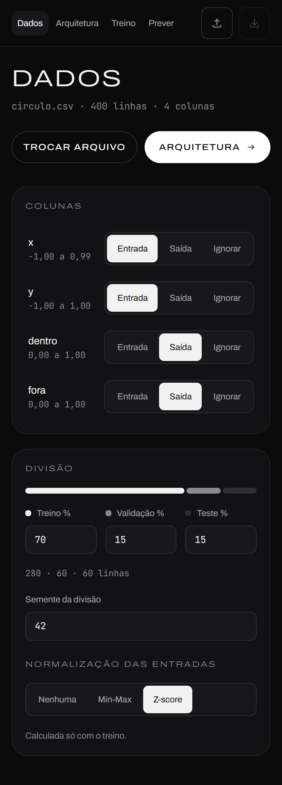
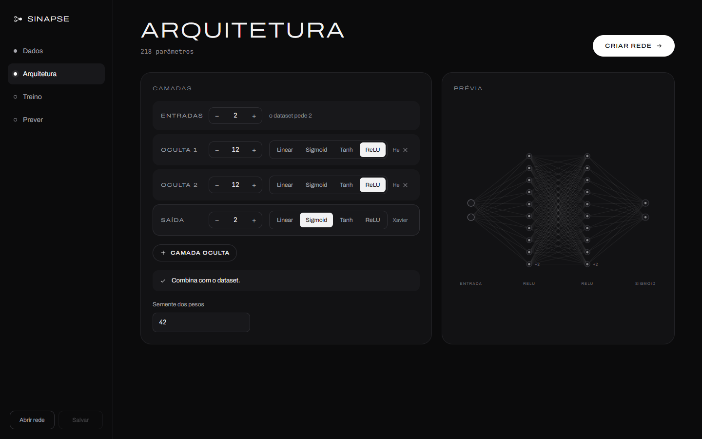
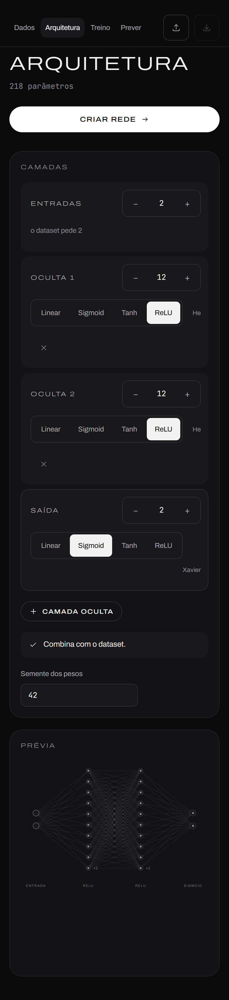
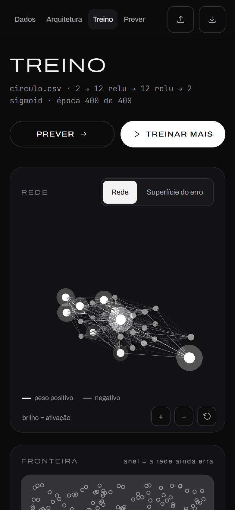
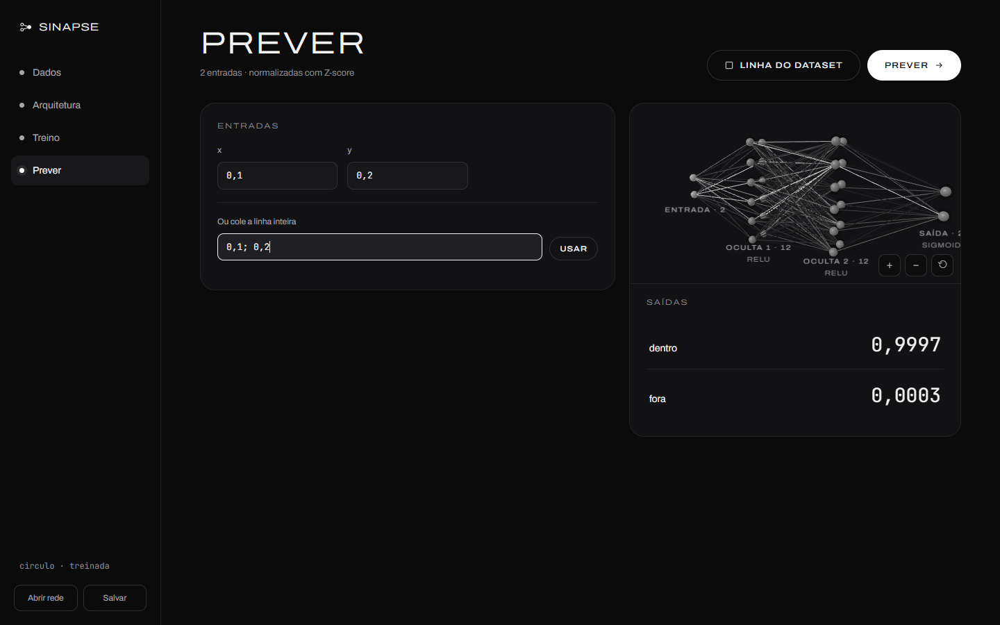
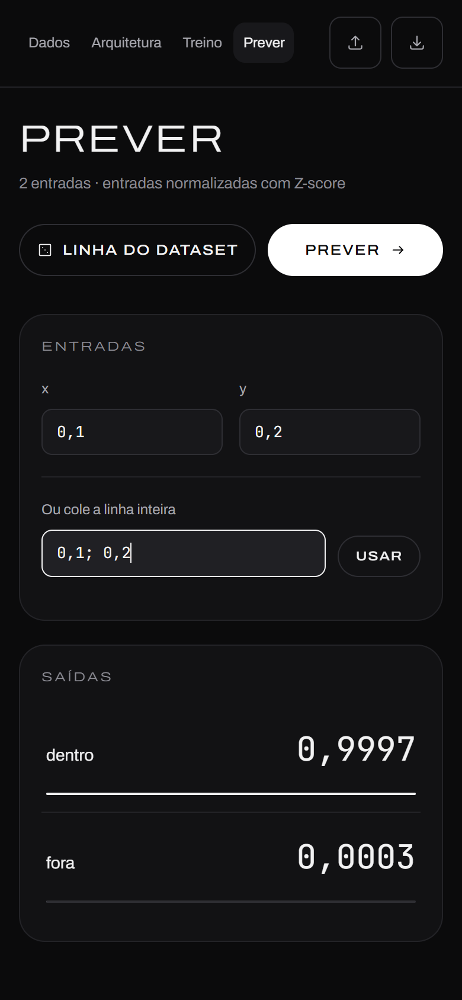

# Sinapse: redes MLP configuráveis

Trabalho Avaliativo 02 de Ciência da Computação (UNIJUÍ): um sistema para montar, configurar, treinar, salvar e usar redes neurais
do tipo Multilayer Perceptron, sem precisar mexer no código para mudar a arquitetura.

No ar em https://sinapse-mlp.vercel.app (publicar de novo: `publicar.cmd`).

Ele roda no navegador e foi feito em TypeScript. Toda a rede (neurônio, camada, propagação, erro, retropropagação e SGD) foi
escrita do zero. Nenhuma biblioteca de rede neural ou de diferenciação automática é usada: as dependências são só o Vite
(servidor e build), o Vitest (testes) e as fontes.

## Como rodar

Precisa do Node.js 18 ou mais novo.

```bash
npm install
npm run dev      # abre em http://localhost:5191
npm test         # 19 testes do núcleo
npm run build    # gera a versão estática em dist/
```

A pasta `dist/` funciona em qualquer servidor estático (`npm run preview` serve ela em http://localhost:5192).

## Como usar

1. **Dados:** solte um CSV ou escolha um dos exemplos. Em cada coluna, diga se ela é *Entrada*, *Saída* ou *Ignorar*. Defina
   os percentuais de treino, validação e teste (precisam somar 100%), a semente da divisão e a normalização das entradas
   (Nenhuma, Min-Max ou Z-score).
2. **Arquitetura:** número de entradas, camadas ocultas (adicionar e remover), neurônios e função de ativação de cada camada,
   e a semente dos pesos. A tela avisa se a rede não combina com as colunas do dataset. **Criar rede** inicializa os pesos.
3. **Treino:** taxa de aprendizado, número de épocas e semente da ordem dos exemplos. Durante o treino aparecem a rede (as
   ligações mudam de espessura com o peso), a curva do MSE do treino e da validação a cada época, e no fim o MSE do teste.
   Dá para pausar, continuar e parar.
4. **Prever:** digite os valores de entrada (ou cole a linha inteira, separada por `;`) e veja as saídas. O botão *Linha do
   dataset* preenche com uma linha real e mostra o valor esperado ao lado.
5. **Salvar / Abrir rede** (barra lateral): grava e lê a rede em JSON.

Os números aceitam vírgula ou ponto como casa decimal.

### Datasets de exemplo

Ficam em `public/exemplos/` e são **sintéticos**, gerados por fórmula em `scripts/gerar-exemplos.mjs` (`npm run exemplos`):

| Arquivo | Entradas → saídas | Para que serve |
|---|---|---|
| `xor.csv` | a, b → xor | o problema clássico que precisa de camada oculta |
| `seno.csv` | ângulo em graus (0 a 360) → seno | regressão; a entrada em escala grande mostra o efeito da normalização |
| `circulo.csv` | x, y → dentro, fora | classificação com duas saídas (ponto dentro do círculo de raio 0,6) |

## Onde está cada requisito

| Requisito | Arquivo |
|---|---|
| 1.1 Neurônio (pesos, viés, z, saída, δ) | `src/core/neuron.ts` |
| 1.2 Camada | `src/core/layer.ts` |
| 1.3 Rede neural | `src/core/network.ts` |
| 1.4 Funções de ativação e derivadas | `src/core/activations.ts` |
| 1.5 Inicialização Xavier/He com semente | `src/core/initialization.ts`, `src/core/random.ts` |
| 1.6 Propagação direta | `Network.forward` em `src/core/network.ts` |
| 1.7 MSE | `src/core/loss.ts` |
| 1.8 Retropropagação e descida do gradiente | `Network.backward` e `Network.update` em `src/core/network.ts` |
| 1.9 CSV, compatibilidade, divisão e normalização | `src/core/dataset.ts`, `src/core/normalization.ts` |
| 1.10 Treinamento SGD | `src/core/trainer.ts` (roda em `src/train.worker.ts`) |
| 1.11 Persistência em JSON | `src/core/persistence.ts` |
| 1.12 Previsão | `src/core/predict.ts` |
| Interface | `src/main.ts`, `src/ui/` |

O núcleo (`src/core/`) não depende da interface. A interface só chama as funções dele, e o treino roda num Web Worker para a
tela não travar.

## Detalhes dos algoritmos

- **Ativações:** Linear, Sigmoid, Tanh e ReLU. A derivada da ReLU em z = 0 é tratada como 0.
- **Inicialização:** Xavier/Glorot normal, σ = √(2 / (n_entradas + n_saídas)), nas camadas Linear, Sigmoid e Tanh. He normal,
  σ = √(2 / n_entradas), nas camadas ReLU. A normal vem de Box-Muller sobre um gerador Mulberry32 com semente, então a
  mesma semente gera os mesmos pesos. Os vieses começam em 0 e são salvos como os pesos.
- **Erro usado no gradiente:** por exemplo, E = ½ Σₖ (oₖ − tₖ)².
  - Saída: δₖ = (oₖ − tₖ) · f′(zₖ)
  - Oculta: δⱼ = f′(zⱼ) · Σₖ wₖⱼ · δₖ
  - Todos os deltas são calculados antes de qualquer peso mudar. Depois vem a atualização: w ← w − η · δ · x e b ← b − η · δ.
- **MSE informado:** a média de (o − t)² sobre todos os exemplos e todas as saídas do conjunto.
- **SGD:** os pesos são atualizados depois de cada exemplo. A cada época os exemplos de treino são embaralhados com a semente
  do treino. Ao fim da época são calculados o MSE do treino e o da validação, só com propagação direta. O teste só é avaliado
  no fim. Se o erro virar infinito, o treino para e sugere uma taxa menor ou a normalização.
- **Divisão:** embaralhamento Fisher-Yates com semente. Os tamanhos são arredondados para manter o total de linhas.
- **Normalização:** feita depois da divisão, com os parâmetros calculados só no treino e aplicados aos três conjuntos e às
  entradas da previsão. Min-Max: (x − mín) / (máx − mín). Z-score: (x − média) / desvio (desvio populacional). Coluna
  constante vira 0. As saídas esperadas nunca são normalizadas.
- **Compatibilidade:** o número de colunas de entrada precisa ser igual ao de entradas da rede, e o de colunas de saída igual
  ao de neurônios da última camada. Sem isso, o treino fica bloqueado com a explicação na tela.

## Formato do arquivo da rede (JSON)

```json
{
  "formato": "sinapse-mlp",
  "versao": 1,
  "entradas": 2,
  "quantidadeCamadas": 2,
  "camadas": [
    {
      "neuronios": 3,
      "ativacao": "tanh",
      "pesos": [[0.41, -0.2], [0.05, 0.9], [-0.7, 0.33]],
      "vieses": [0.01, -0.12, 0.3]
    },
    {
      "neuronios": 1,
      "ativacao": "sigmoid",
      "pesos": [[1.2, -0.8, 0.4]],
      "vieses": [-0.05]
    }
  ],
  "normalizacao": { "tipo": "minmax", "min": [0, 0], "max": [1, 1] },
  "colunas": { "entradas": ["a", "b"], "saidas": ["xor"] }
}
```

| Campo | Conteúdo |
|---|---|
| `formato`, `versao` | identificam o arquivo (`"sinapse-mlp"`, versão 1) |
| `entradas` | quantidade de entradas da rede |
| `quantidadeCamadas` | camadas com neurônios (ocultas + saída) |
| `camadas[].neuronios` | neurônios da camada |
| `camadas[].ativacao` | `"linear"`, `"sigmoid"`, `"tanh"` ou `"relu"` |
| `camadas[].pesos[i][j]` | peso do neurônio *i* para a entrada *j* da camada |
| `camadas[].vieses[i]` | viés do neurônio *i* |
| `normalizacao` | `null`, `{ "tipo": "minmax", "min": [...], "max": [...] }` ou `{ "tipo": "zscore", "media": [...], "desvio": [...] }`, um valor por entrada, calculados no treino |
| `colunas` | opcional: nomes das colunas, só para a tela rotular os campos |

Ao abrir, o arquivo é conferido inteiro: formato, número de pesos por neurônio, números válidos e normalização com o tamanho
certo. A rede reconstruída dá exatamente as mesmas saídas da original. Há um teste que confere isso.

## Testes

`npm test` roda 19 testes em `tests/core.test.ts`:

- as derivadas das quatro ativações batem com a derivada numérica;
- Xavier e He são escolhidos pela ativação, com o desvio esperado, e a mesma semente dá os mesmos pesos;
- o gradiente da retropropagação bate com o gradiente numérico numa rede de 4 camadas que usa as quatro funções;
- os deltas das ocultas usam os pesos de antes da atualização;
- a rede aprende o XOR;
- o MSE é a média sobre exemplos e saídas;
- a validação não altera o treino;
- o CSV é lido e os erros de leitura aparecem;
- a divisão é reproduzível e a normalização usa só o treino (as saídas não são normalizadas);
- uma rede salva e aberta dá as mesmas saídas, a previsão confere a quantidade de valores e um arquivo quebrado é recusado
  com uma mensagem clara.

## Estrutura

```
src/
  core/            entidades e algoritmos (sem interface)
  train.worker.ts  treino em segundo plano
  ui/              telas, desenho da rede, gráfico, estilos
  main.ts          barra lateral, navegação, salvar e abrir
tests/             testes do núcleo (Vitest)
public/exemplos/   datasets sintéticos
scripts/           gerador dos exemplos
```

## Prints

Tirados da interface rodando, com o `scripts/prints.mjs` (`npm run dev` ligado e depois `node scripts/prints.mjs`), em `docs/prints/`:

| Tela | Computador | Celular |
|---|---|---|
| Dados |  |  |
| Arquitetura |  |  |
| Treino |  |  |
| Prever |  |  |
