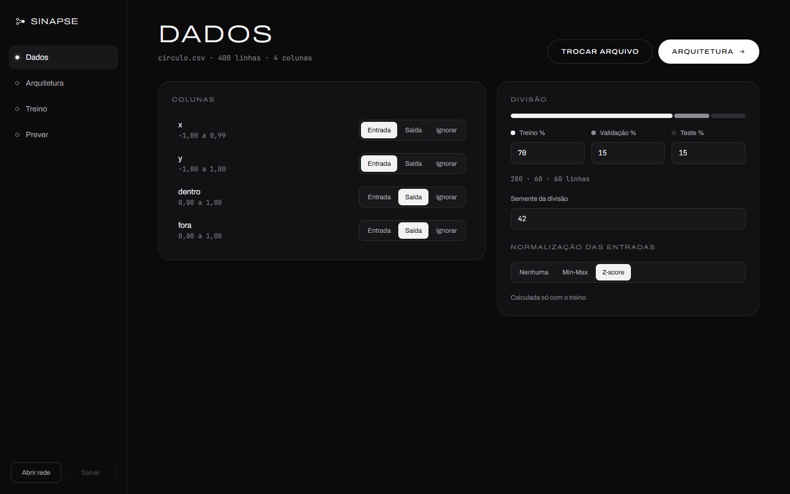
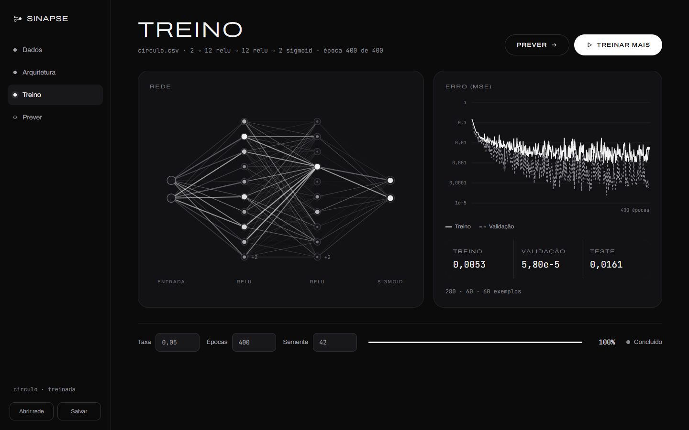

# Sinapse: redes MLP configuráveis

Trabalho Avaliativo 02 de Ciência da Computação (UNIJUÍ): um sistema para montar, configurar, treinar, salvar e usar redes neurais
do tipo Multilayer Perceptron, sem precisar mexer no código para mudar a arquitetura.

No ar em https://sinapse-mlp.vercel.app (publicar de novo: `publicar.cmd`).

Ele roda no navegador e foi feito em TypeScript. Toda a rede (neurônio, camada, propagação, erro, retropropagação e SGD) foi
escrita do zero. Nenhuma biblioteca de rede neural ou de diferenciação automática é usada: as dependências são só o Vite
(servidor e build), o Vitest (testes) e as fontes.

## Como rodar

Precisa do Node.js 18 ou mais novo.

```bash
npm install
npm run dev      # abre em http://localhost:5191
npm test         # 19 testes do núcleo
npm run build    # gera a versão estática em dist/
```

A pasta `dist/` funciona em qualquer servidor estático (`npm run preview` serve ela em http://localhost:5192).

## Como usar

1. **Dados:** solte um CSV ou escolha um dos exemplos. Em cada coluna, diga se ela é *Entrada*, *Saída* ou *Ignorar*. Defina
   os percentuais de treino, validação e teste (precisam somar 100%), a semente da divisão e a normalização das entradas
   (Nenhuma, Min-Max ou Z-score).
2. **Arquitetura:** número de entradas, camadas ocultas (adicionar e remover), neurônios e função de ativação de cada camada,
   e a semente dos pesos. Cada camada pode ter **blocos em paralelo** (botão *+ Bloco*): cada bloco tem seus neurônios, sua
   ativação e as origens que você marca em *recebe de* (na 1ª camada, as entradas; nas outras, os blocos da camada anterior).
   A tela avisa se a rede não combina com as colunas do dataset. **Criar rede** inicializa os pesos.
3. **Treino:** taxa de aprendizado, número de épocas e semente da ordem dos exemplos. Durante o treino aparecem a rede (as
   ligações mudam de espessura com o peso), a curva do MSE do treino e da validação a cada época, e no fim o MSE do teste.
   Dá para pausar, continuar e parar.
4. **Prever:** digite os valores de entrada (ou cole a linha inteira, separada por `;`) e veja as saídas. O botão *Linha do
   dataset* preenche com uma linha real e mostra o valor esperado ao lado.
5. **Salvar / Abrir rede** (barra lateral): grava e lê a rede em JSON.

Os números aceitam vírgula ou ponto como casa decimal. O CSV pode vir do Excel em português: separado por `;` ou tab,
com vírgula decimal (`5,1`) e com qualquer quebra de linha (`\r\n`, `\n` ou só `\r`). A tela Dados mostra as primeiras
linhas como foram lidas.

### Desenhe um número, Laboratório e Apresentar

- **Desenhe um número** (exemplo *Dígitos*): o conjunto `digits` do scikit-learn (1.797 dígitos escritos à mão, 8×8 pixels
  de 0 a 16, licença BSD) vira um exemplo, já com uma arquitetura sugerida (64 → 32 ReLU → 10 sigmoid, 30 épocas, chega a
  cerca de 96% de acerto no teste). Depois de treinar, a tela Prever troca os 64 campos por um quadro: você desenha um número
  com o mouse ou o dedo e a rede responde na hora, com a confiança e a barra de cada dígito. O desenho passa pelo mesmo
  caminho do conjunto original: grade 32×32 em preto e branco, centralizada, contada em blocos 4×4 (0 a 16 por bloco).
- **Laboratório** (menu): clique para pôr pontos de até três classes (teclas 1, 2 e 3 trocam a classe; botão direito apaga) e
  uma rede de verdade, com o mesmo núcleo, treina sem parar com eles. A fronteira se forma na hora; dá para mudar camadas,
  neurônios, ativação e taxa no meio. *Usar como dataset* leva os pontos para a tela Dados como um CSV (x, y, classe).
- **Apresentar** (menu): roda a demonstração sozinha em 8 passos com legendas — dados, a rede sendo montada, o treino ao vivo,
  fronteira e matriz, superfície do erro, previsão e o Laboratório. Tudo acontece de verdade no app. Esc ou *Sair* para.

### Ferramentas de análise (tela Treino)

- **Um exemplo (passo a passo):** faz um passo do SGD com o próximo exemplo do treino e mostra todas as contas: entrada
  `x`, saída `o`, esperado `t`, o erro `E = ½Σ(o − t)²`, o `z`, a saída e o `δ` de cada neurônio, e os pesos e vieses que
  mais mudaram (antes → depois). Os pesos mudam de verdade; a rede mostra o passo acontecendo.
- **Clique num neurônio** (no 3D ou no 2D): mostra a ativação, o viés, `z`, a saída, o `δ` e os pesos que chegam nele.
- **Parada antecipada** (campo *Paciência*): com um valor maior que 0, o treino para quando o MSE da validação passa esse
  número de épocas sem melhorar e a rede volta aos pesos da melhor época. O gráfico marca a melhor época. A validação
  continua sem ajustar nada: ela só decide quando parar.
- **Matriz de confusão** (classificação): no conjunto de teste, real × previsto, com o acerto de cada classe.
- **Execuções:** cada treino fica numa tabela (arquitetura, taxa, épocas, MSE de treino/validação/teste, acerto e a curva
  da validação), com a de menor erro na validação destacada, para comparar redes. Fica guardada no navegador.
- **Relatório:** abre a impressão com um relatório da execução (resultado, curva do erro, matriz de confusão, desenho da
  rede, colunas, divisão, normalização com os parâmetros, treinamento e ajuste dos pesos). Em *Salvar como PDF* vira o
  arquivo para entregar.
- **Como foi feito:** um quadro explica a divisão, o treino e o ajuste dos pesos com os números da execução.

### Colunas com rótulos em texto

Uma coluna toda em texto (por exemplo `especie` com `setosa`, `versicolor`, `virginica`) é lida como **rótulo de classe**:

- vira uma posição por classe (one-hot): uma saída `especie` com 3 classes pede 3 neurônios na camada de saída, e a tela de
  Arquitetura já ajusta isso sozinha;
- também pode ser entrada, e aí ocupa uma entrada por classe;
- na previsão, a tela mostra o nome da classe vencedora (a de maior valor) e a barra de cada classe; para digitar, a entrada de
  texto vira uma escolha entre as classes;
- quando a saída é de classificação, o treino mostra a **taxa de acerto** na validação a cada época e no teste no fim.

Coluna que mistura números e texto é tratada como erro de digitação e acusada com a linha. Célula vazia também é erro.
O máximo é de 50 classes por coluna.

### Blocos em paralelo

Uma camada pode se dividir em blocos lado a lado. Exemplo: com as entradas `x, y, idade, renda`, a primeira camada pode ter
um bloco A de 8 neurônios tanh ligado só a `x, y` e um bloco B de 4 neurônios ReLU ligado só a `idade, renda`; a camada
seguinte recebe de A e B (ou só de um deles). As saídas dos blocos ficam em sequência, A primeiro.

A matemática é a mesma da MLP: cada neurônio guarda de quais saídas da camada anterior ele recebe (`sources`), soma só
essas (`z = Σ wₚ·x[origem p] + b`), e na retropropagação o delta de um neurônio oculto soma só os neurônios da camada
seguinte que estão ligados a ele (`δⱼ = f′(zⱼ) · Σ wₖⱼ δₖ`, para os k que recebem de j). Uma camada sem blocos é a camada
comum, ligada a tudo. Um teste compara esses gradientes com a derivada numérica numa rede com blocos.

### Visualizações (dados reais, nada decorativo)

- **Rede 3D ou 2D** (Treino, escolha em *3D / 2D*): um nó por neurônio, só as ligações que existem, cada uma com a cor e
  o brilho do peso atual (branco = positivo, cinza = negativo); blocos em paralelo aparecem como grupos separados.
  Durante o treino, um exemplo de treino faz o **ciclo inteiro**: os pulsos brancos vão camada por camada com o brilho de
  cada nó igual à sua ativação, o erro volta da saída para a entrada (pulsos cinza, com a força dos deltas calculados de
  verdade) e as ligações piscam quando os pesos são atualizados.
- **Prévia na Arquitetura**: a rede em 3D (com os pesos iniciais de verdade) acompanha cada opção escolhida; só as camadas que mudaram nascem de novo, com os nós crescendo e as ligações se desenhando.
- **Tela inicial**: uma rede de verdade (2 → 5 tanh → 1 sigmoid) aprendendo XOR ao vivo com o mesmo núcleo, mostrando o
  mesmo ciclo e o erro caindo.
- **Superfície do erro** (Treino): o MSE do treino quando só dois pesos variam (os dois que mais mudaram desde o começo) e os
  outros ficam como estão agora, com o caminho que esses dois pesos fizeram durante o treino. É calculada no worker.
- **Fronteira** (Treino): com 2 entradas numéricas, a classe que a rede escolhe em cada ponto do plano, com os exemplos reais
  por cima; um anel vermelho marca os que ela ainda erra. Com 1 entrada, a curva da rede sobre os pontos.
- **Previsão acendendo** (Prever): ao prever, a rede 3D acende camada por camada com as ativações daquela entrada.

**Câmera:** arrastar gira; botão direito, Shift + arrastar ou dois dedos movem; roda ou pinça aproximam; duplo clique volta à
vista inicial. Também há botões +, − e ⟲ na cena, e com o foco nela as setas giram, + e − aproximam e 0 centraliza. Sem
WebGL, a rede aparece no desenho 2D com os mesmos pesos.

### Datasets de exemplo

Ficam em `public/exemplos/`. Os quatro primeiros são **sintéticos**, gerados por fórmula em `scripts/gerar-exemplos.mjs`
(`npm run exemplos`); o de dígitos é real:

| Arquivo | Entradas → saídas | Para que serve |
|---|---|---|
| `xor.csv` | a, b → xor | o problema clássico que precisa de camada oculta |
| `seno.csv` | ângulo em graus (0 a 360) → seno | regressão; a entrada em escala grande mostra o efeito da normalização |
| `circulo.csv` | x, y → dentro, fora | classificação com duas saídas (ponto dentro do círculo de raio 0,6) |
| `digitos.csv` | 64 pixels (p00…p77, 0 a 16) → digito (`zero`…`nove`) | **dados reais**: o conjunto `digits` do scikit-learn (BSD), dígitos escritos à mão |
| `espiral.csv` | x, y → braco (`norte`, `leste`, `oeste`) | classificação com **rótulo em texto**, três braços de uma espiral |

## Onde está cada requisito

| Requisito | Arquivo |
|---|---|
| 1.1 Neurônio (pesos, viés, z, saída, δ) | `src/core/neuron.ts` |
| 1.2 Camada | `src/core/layer.ts` |
| 1.3 Rede neural | `src/core/network.ts` |
| 1.4 Funções de ativação e derivadas | `src/core/activations.ts` |
| 1.5 Inicialização Xavier/He com semente | `src/core/initialization.ts`, `src/core/random.ts` |
| 1.6 Propagação direta | `Network.forward` em `src/core/network.ts` |
| 1.7 MSE | `src/core/loss.ts` |
| 1.8 Retropropagação e descida do gradiente | `Network.backward` e `Network.update` em `src/core/network.ts` |
| 1.9 CSV, compatibilidade, divisão e normalização | `src/core/dataset.ts`, `src/core/normalization.ts` |
| 1.10 Treinamento SGD | `src/core/trainer.ts` (roda em `src/train.worker.ts`) |
| 1.11 Persistência em JSON | `src/core/persistence.ts` |
| 1.12 Previsão | `src/core/predict.ts` |
| Interface | `src/main.ts`, `src/ui/` |

O núcleo (`src/core/`) não depende da interface. A interface só chama as funções dele, e o treino roda num Web Worker para a
tela não travar.

## Detalhes dos algoritmos

- **Ativações:** Linear, Sigmoid, Tanh e ReLU. A derivada da ReLU em z = 0 é tratada como 0.
- **Inicialização:** Xavier/Glorot normal, σ = √(2 / (n_entradas + n_saídas)), nas camadas Linear, Sigmoid e Tanh. He normal,
  σ = √(2 / n_entradas), nas camadas ReLU. A normal vem de Box-Muller sobre um gerador Mulberry32 com semente, então a
  mesma semente gera os mesmos pesos. Os vieses começam em 0 e são salvos como os pesos.
- **Erro usado no gradiente:** por exemplo, E = ½ Σₖ (oₖ − tₖ)².
  - Saída: δₖ = (oₖ − tₖ) · f′(zₖ)
  - Oculta: δⱼ = f′(zⱼ) · Σₖ wₖⱼ · δₖ
  - Todos os deltas são calculados antes de qualquer peso mudar. Depois vem a atualização: w ← w − η · δ · x e b ← b − η · δ.
- **MSE informado:** a média de (o − t)² sobre todos os exemplos e todas as saídas do conjunto.
- **SGD:** os pesos são atualizados depois de cada exemplo. A cada época os exemplos de treino são embaralhados com a semente
  do treino. Ao fim da época são calculados o MSE do treino e o da validação, só com propagação direta. O teste só é avaliado
  no fim. Se o erro virar infinito, o treino para e sugere uma taxa menor ou a normalização.
- **Divisão:** embaralhamento Fisher-Yates com semente. Os tamanhos são arredondados para manter o total de linhas.
- **Normalização:** feita depois da divisão, com os parâmetros calculados só no treino e aplicados aos três conjuntos e às
  entradas da previsão. Min-Max: (x − mín) / (máx − mín). Z-score: (x − média) / desvio (desvio populacional). Coluna
  constante vira 0. As saídas numéricas também são normalizadas (com Min-Max ou Z-score escolhido; com *Nenhuma*, não):
  Min-Max pelo treino para a faixa da ativação de saída — Sigmoid, Linear e ReLU de 0 a 1, Tanh de −1 a 1. A previsão
  desfaz a conta e mostra o valor na unidade do arquivo; o Treino mostra o MSE do teste também nessa unidade. Saídas de
  classe já são 0 e 1 (one-hot) e passam sem mudar.
- **Compatibilidade:** o número de colunas de entrada precisa ser igual ao de entradas da rede, e o de colunas de saída igual
  ao de neurônios da última camada. Sem isso, o treino fica bloqueado com a explicação na tela.

## Formato do arquivo da rede (JSON)

```json
{
  "formato": "sinapse-mlp",
  "versao": 1,
  "entradas": 2,
  "quantidadeCamadas": 2,
  "camadas": [
    {
      "neuronios": 3,
      "ativacao": "tanh",
      "pesos": [[0.41, -0.2], [0.05, 0.9], [-0.7, 0.33]],
      "vieses": [0.01, -0.12, 0.3]
    },
    {
      "neuronios": 1,
      "ativacao": "sigmoid",
      "pesos": [[1.2, -0.8, 0.4]],
      "vieses": [-0.05]
    }
  ],
  "normalizacao": { "tipo": "minmax", "min": [0, 0], "max": [1, 1] },
  "colunas": { "entradas": ["a", "b"], "saidas": ["xor"] }
}
```

| Campo | Conteúdo |
|---|---|
| `formato`, `versao` | identificam o arquivo (`"sinapse-mlp"`, versão 1) |
| `entradas` | quantidade de entradas da rede |
| `quantidadeCamadas` | camadas com neurônios (ocultas + saída) |
| `camadas[].neuronios` | neurônios da camada |
| `camadas[].ativacao` | `"linear"`, `"sigmoid"`, `"tanh"` ou `"relu"` |
| `camadas[].pesos[i][j]` | peso do neurônio *i* para a entrada *j* da camada |
| `camadas[].vieses[i]` | viés do neurônio *i* |
| `normalizacao` | `null`, `{ "tipo": "minmax", "min": [...], "max": [...] }` ou `{ "tipo": "zscore", "media": [...], "desvio": [...] }`, um valor por entrada, calculados no treino |
| `normalizacaoSaidas` | opcional: `{ "min": [...], "max": [...], "lo": [...], "hi": [...] }`, um valor por saída; cada saída vai de [min, max] do treino para [lo, hi] da ativação. Ausente em redes salvas antes: saídas como no arquivo |
| `colunas` | opcional: nomes das posições, só para a tela rotular os campos |
| `camadas[].blocos` | opcional: blocos em paralelo, na ordem dos neurônios, cada um `{ "neuronios", "ativacao", "origem"? }`; `origem` = índices das entradas (1ª camada) ou dos blocos da camada anterior; sem `origem`, o bloco recebe de tudo. Num bloco com origem, `pesos[i]` tem um peso por saída de origem, em ordem |
| `codificacao` | opcional: como cada coluna do CSV virou números, `{ "entradas": [...], "saidas": [...] }`, cada item `{ "nome", "tipo": "numero" }` ou `{ "nome", "tipo": "classe", "classes": [...] }`; uma coluna de classe ocupa uma posição por classe, na ordem da lista |

Ao abrir, o arquivo é conferido inteiro: formato, número de pesos por neurônio, números válidos e normalização com o tamanho
certo. A rede reconstruída dá exatamente as mesmas saídas da original. Há um teste que confere isso.

## Testes

`npm test` roda 30 testes em `tests/core.test.ts`:

- as derivadas das quatro ativações batem com a derivada numérica;
- Xavier e He são escolhidos pela ativação, com o desvio esperado, e a mesma semente dá os mesmos pesos;
- o gradiente da retropropagação bate com o gradiente numérico numa rede de 4 camadas que usa as quatro funções;
- os deltas das ocultas usam os pesos de antes da atualização;
- a rede aprende o XOR;
- o MSE é a média sobre exemplos e saídas;
- a validação não altera o treino;
- o CSV é lido e os erros de leitura aparecem;
- a divisão é reproduzível e a normalização usa só o treino (as saídas não são normalizadas);
- uma rede salva e aberta dá as mesmas saídas, a previsão confere a quantidade de valores e um arquivo quebrado é recusado
  com uma mensagem clara;
- coluna de texto vira classes (one-hot) e conta uma saída por classe; a classe vencedora e a taxa de acerto saem certas; a
  rede com rótulos salva e abre com as classes;
- CSV no formato do Excel em português (`;`, vírgula decimal, só `\r`);
- parada antecipada: para depois de `paciência` épocas sem melhorar e volta aos melhores pesos; desligada, roda tudo;
- matriz de confusão por classe e no caso 0/1;
- blocos em paralelo: cada bloco só recebe das origens escolhidas, os gradientes batem com o numérico, a rede salva e abre
  com os blocos, bloco sem origem é recusado e uma rede com dois blocos aprende XOR.

## Estrutura

```
src/
  core/            entidades e algoritmos (sem interface)
  train.worker.ts  treino em segundo plano
  ui/              telas, desenho da rede, gráfico, estilos
  main.ts          barra lateral, navegação, salvar e abrir
tests/             testes do núcleo (Vitest)
public/exemplos/   datasets sintéticos
scripts/           gerador dos exemplos
```

## Prints

Tirados da interface rodando, com o `scripts/prints.mjs` (`npm run dev` ligado e depois `node scripts/prints.mjs`), em `docs/prints/`:

| Tela | Computador | Celular |
|---|---|---|
| Dados |  |  |
| Arquitetura |  |  |
| Treino |  |  |
| Prever |  |  |
